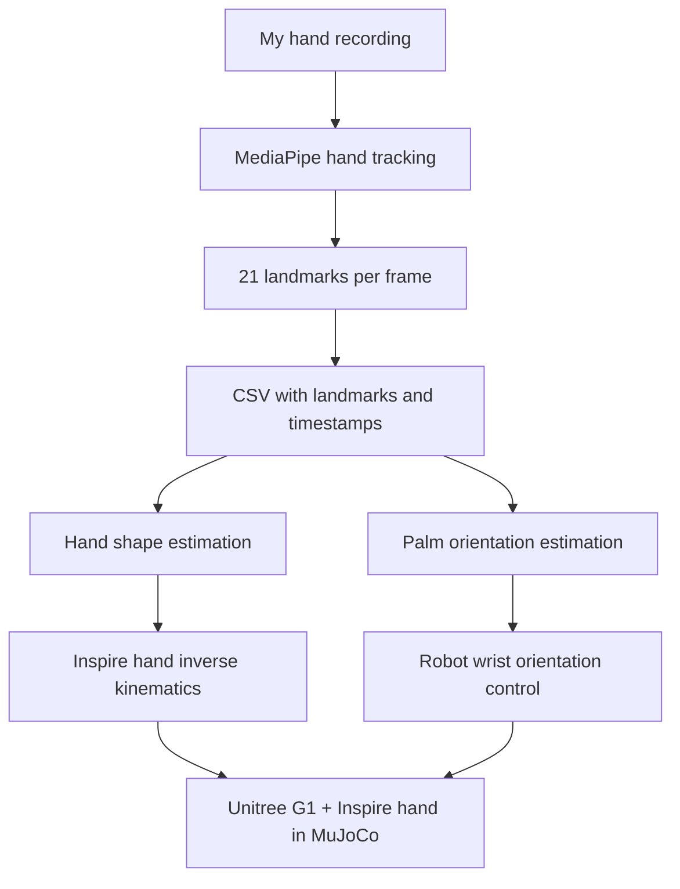
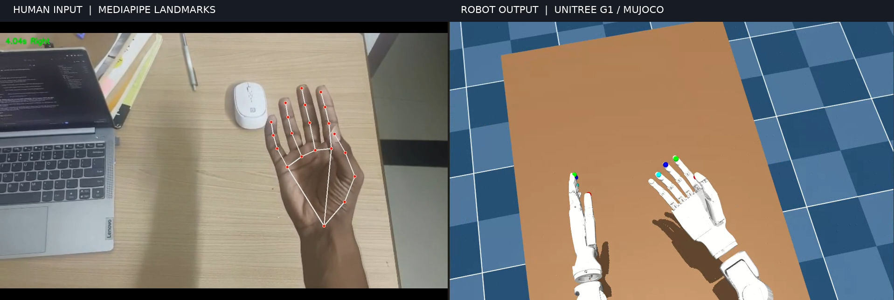

# Human-to-Robot Hand Retargeting

**A hand-recorded movement, replayed on a humanoid robot.**

This started with a simple question: can I record my own hand movements and get a robot hand to follow them?

For this project, I used MediaPipe to track my hand from a normal video, converted the tracking data into a CSV, and used that data to drive an Inspire five-finger hand mounted on a Unitree G1 in MuJoCo.

The idea is to make the robot follow the movement I actually recorded, rather than giving it a hand-written sequence of poses. It is still a work in progress, but the hand shape and palm rotation from the recording are now being retargeted to the simulated robot.

---

## What does it do?

The pipeline is fairly straightforward:

1. I record a hand movement using a regular RGB camera.
2. MediaPipe detects 21 landmarks on the hand in each frame.
3. Those landmarks are saved, along with timestamps, in a CSV file.
4. The replay script reads the CSV and works out the hand shape and how the palm is rotating.
5. It converts that movement into targets the Inspire hand and the robot wrist can follow.
6. MuJoCo plays the movement on the Unitree G1 model.

The important part is that the CSV drives the movement. The script is not told to "open the hand, turn the palm, then close the fingers". It works from the motion in the recording.

## A quick look at the pipeline



## What is happening behind the scenes?

### 1. Getting the hand movement

MediaPipe gives 21 points for each detected hand: the wrist, finger joints and fingertips.

I use two sets of landmark data for slightly different jobs:

- The hand-centred 3D landmarks help describe the shape of the fingers.
- The image landmarks, including their relative depth estimate, help estimate how the palm is turning relative to the camera.

The replay builds a local reference frame for the palm and compares each frame with the first reliable frame of the recording. This lets it follow the rotation that actually happened in the video.

There is some filtering in between. Hand tracking is not perfectly stable, especially when fingers overlap, landmarks disappear or the palm is viewed at an awkward angle. Without filtering, a small tracking error can look like a sudden wrist movement.

### 2. Making a human hand fit a robot hand

This part was more interesting than I expected.

A human hand has a lot of joints, but the Inspire hand does not expose a separate motor for every human joint. It has six independently controlled inputs per hand:

- Index finger
- Middle finger
- Ring finger
- Little finger
- Thumb flexion
- Thumb opposition

So instead of copying human joint angles directly, the controller looks at the positions of the fingertips and some intermediate finger points. It then finds a set of robot actuator values that gets the robot as close as it can to that shape.

In other words, the goal is to reproduce the useful hand pose and movement, even though the human and robot hands are built differently.

### 3. Making the palm turn the right way

The palm orientation is calculated relative to the starting pose of the recording. That relative rotation is then mapped to the robot hand's coordinate frame.

The robot uses its wrist roll, pitch and yaw joints to follow the palm rotation. For this version, the wrist position stays fixed, and the shoulder, elbow and waist are held in their starting positions. This keeps the demonstration focused on the hand and wrist instead of letting the whole robot move around to compensate.

The hand and wrist are controlled separately: the hand IK handles the fingers, while the wrist IK handles palm orientation.

## Robot and simulation

The simulation uses:

- **Robot:** Unitree G1
- **Hand:** Inspire five-finger hand
- **Simulator:** MuJoCo
- **Tracking:** MediaPipe
- **Language:** Python

The current scene is a fixed-pelvis G1 model with Inspire hands. The controller also configures the robot's body motors as position-style PD servos at runtime and applies gravity compensation in the compiled MuJoCo model. The original XML files are not rewritten by the replay script.

## Repository layout

The main files are organised roughly like this:

```text
.
├── README.md
├── replay.py
├── requirements.txt
├── output_csv/
│   ├── lfingers.csv
│   └── rfingers.csv
├── unitree_mujoco/
│   └── unitree_robots/
│       └── g1/
│           ├── scene_hand_only.xml
│           ├── g1_29dof_inspire_fixed.xml
│           └── meshes/
└── results/
    └── images/
        └── hand_retargeting_comparison.png
```

The scene XML needs to be kept together with the robot model and the mesh files it references. If your local filenames or folders differ, update the scene path used when launching the replay.

## Getting it running

The replay was developed on Linux.

### 1. Clone the repository

```bash
git clone https://github.com/sreeragkz/human-to-robot-hand-retargeting.git
cd human-to-robot-hand-retargeting
```

### 2. Create a Python environment

```bash
python3 -m venv .venv
source .venv/bin/activate
python -m pip install --upgrade pip
```

### 3. Install the Python packages

```bash
pip install -r requirements.txt
```

The replay needs MuJoCo, NumPy and Pandas. MediaPipe is needed when extracting landmarks from a video; the replay itself reads the already-generated CSV.

You will also need a working MuJoCo viewer setup (including the required graphics support) and the compatible G1/Inspire model files.

## Running a recording

The replay takes a CSV as input. Keep one hand in each CSV so the intended robot hand can be selected consistently.

### Right hand

```bash
python replay.py --csv output_csv/rfingers.csv
```

### Left hand

```bash
python replay.py --csv output_csv/lfingers.csv
```

### Play it more slowly

```bash
python replay.py --csv output_csv/rfingers.csv --slow 1.5
```

### Use a different scene file

```bash
python replay.py \
    --csv output_csv/rfingers.csv \
    --scene unitree_mujoco/unitree_robots/g1/scene_hand_only.xml
```

`--csv` is required. `--scene` and `--slow` are optional. Run the command from the repository root so the default scene path can be found.

## Results

Here's a comparison between my original hand recording and the corresponding robot replay.

The left side shows the MediaPipe-annotated recording, while the right side shows the Unitree G1 hand following the movement in MuJoCo.



The main result is that the robot can follow the recorded finger articulation and palm rotation, rather than playing a predefined gesture.

## What was difficult?

A few things took more debugging than I expected:

- **The palm kept flipping or rotating strangely.** The hand looked steady in the original video, but the estimated palm frame could suddenly jump when the landmark geometry became unreliable. I had to improve how the palm frame was built and filter unreliable frames.
- **The robot sometimes moved in the wrong direction.** Part of the problem was mixing coordinate systems and treating the left and right hands as if they needed an arbitrary mirror operation. I cleaned up the coordinate mapping so both hands use the same anatomical convention.
- **The whole arm tried to compensate for the wrist.** Letting too many joints move made the robot contort to follow a bad orientation estimate. Locking the shoulder, elbow and waist and using the wrist joints for palm rotation made the result much more controlled.
- **A human hand is not an Inspire hand.** There is no one-to-one mapping between all the joints, so the robot has to approximate the hand shape using the actuators it actually has.

These were useful lessons because the issue was not just getting landmarks from a video. The harder part was making those landmarks meaningful and stable enough to control a completely different hand.

## Current limitations

This is a hand-and-wrist retargeting demo, not a complete humanoid manipulation system yet.

- The wrist position is fixed; this is not full arm or whole-body motion retargeting.
- Palm orientation is estimated from a single RGB camera and MediaPipe's relative-depth information. It is not calibrated motion capture.
- The Inspire hand has fewer independent control inputs than a human hand, so some poses can only be approximated.
- The current demonstration is in simulation. It has not been validated on a physical Unitree G1.
- Occlusion, motion blur, poor lighting and missed landmarks can still affect tracking.

## What I would like to improve next

There is plenty left to try:

- Measure the tracking and retargeting error for each finger.
- Test more hand movements and camera viewpoints.
- Improve the comparison and visualisation of human and robot landmarks.
- Extend the hand retargeting to grasping and object interaction.
- Test the approach with another object and a different grasp.

## Acknowledgements

A few tools and projects made this possible:

- [MediaPipe](https://ai.google.dev/edge/mediapipe/solutions/vision/hand_landmarker) for detecting and tracking hand landmarks.
- [MuJoCo](https://mujoco.org/) for the physics simulation.
- [Unitree Robotics](https://github.com/unitreerobotics) for the G1 robot model ecosystem.
- The developers and maintainers of the Inspire hand model and its MuJoCo integration.

This project was built as part of the **Humanoid Challenge: Teach a Humanoid With Your Own Hands**. Thanks to the organisers for putting together a challenge that gave me a reason to try this out.